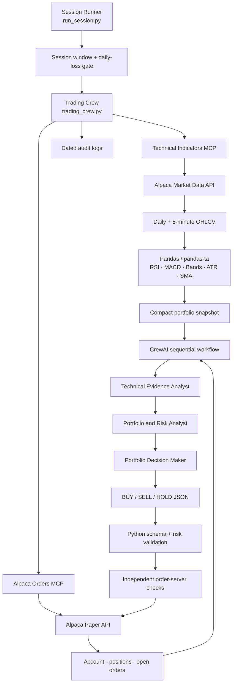
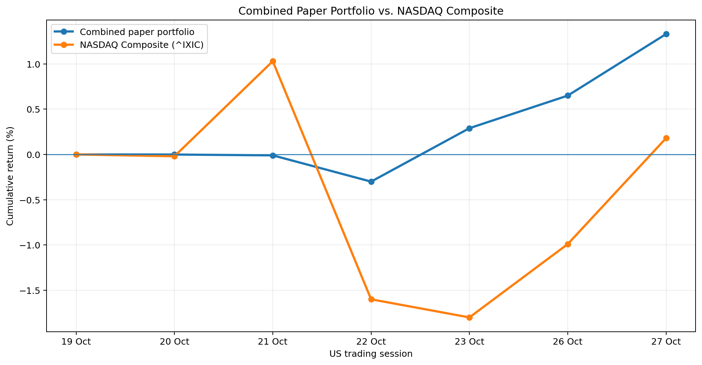

# Autonomous Algorithmic Trading System

<p align="center">
  <b>Multi-agent portfolio analysis and risk-controlled paper trading</b><br>
  Python · CrewAI · MCP · Groq · Alpaca
</p>

<p align="center">
  
  
  
  
  
</p>

An educational Python trading engine that analyses a configured equity portfolio, coordinates specialist LLM agents, applies deterministic risk controls, and submits permitted orders to an **Alpaca paper-trading account**.

The design separates three concerns: market-data computation, agent-based interpretation, and broker-side execution safety. Python retrieves and calculates market evidence; CrewAI orchestrates the analysis; independent Python and MCP checks validate proposed orders. The LLM is not trusted as an unrestricted order authority.

> **Paper trading only.** This project is not investment advice or a production-ready live trading system.

## Contents

- [Highlights](#highlights)
- [Architecture](#architecture)
- [Trading-cycle walkthrough](#trading-cycle-walkthrough)
- [Multi-agent workflow](#multi-agent-workflow)
- [Market data and indicators](#market-data-and-indicators)
- [Risk controls](#risk-controls)
- [Technology stack](#technology-stack)
- [Repository structure](#repository-structure)
- [Setup](#setup)
- [Run](#run)
- [Configuration](#configuration)
- [Paper-trading results](#paper-trading-results)
- [Limitations and future work](#limitations-and-future-work)
- [Security](#security)

## Highlights

- Portfolio-level, batched OHLCV retrieval rather than one market-data request per ticker.
- Two timeframes: daily bars for broader trend context and five-minute bars for faster momentum and entry timing.
- Three CrewAI specialist roles: technical evidence, portfolio risk, and decision synthesis.
- Local MCP servers separate market-data tools from order-execution tools.
- Python schema validation and an independent order-server risk layer.
- Fail-closed behaviour when required data or account state cannot be verified.
- Three Alpaca paper accounts evaluated against the NASDAQ Composite over seven US trading sessions in October 2026.

## Architecture



### Component responsibilities

| Component | Responsibility |
|---|---|
| `scripts/run_session.py` | Session-window scheduling and daily-loss circuit breaker |
| `crew/trading_crew.py` | MCP client, data orchestration, CrewAI workflow, output validation, order submission |
| `technical_indicators_mcp_server.py` | Batched Alpaca OHLCV retrieval, indicators, beta, portfolio snapshot |
| `alpaca_orders_mcp_server.py` | Account and position tools; independently validated paper-order execution |
| `config/*.yaml` | Per-account portfolio, risk, model, data, and session settings |
| `logs/` | Dated data, decision, safety, and execution records |

## Trading-cycle walkthrough

1. **Session gate:** verify that the configured US market session is open.
2. **Loss circuit breaker:** inspect the persistent halt flag and account equity against the configured loss threshold.
3. **Market data:** fetch daily and intraday OHLCV bars in batches from Alpaca.
4. **Feature calculation:** calculate technical indicators and beta locally in Python.
5. **Portfolio context:** retrieve current cash, equity, positions, and safety status.
6. **Agent analysis:** execute the technical, risk, and decision tasks sequentially.
7. **Output validation:** check symbol coverage, action names, confidence, and notional values.
8. **Risk normalization:** constrain proposed trades using position headroom, cash reserve, data availability, confidence, and halt status.
9. **Execution:** the order MCP server independently rechecks account state and submits permitted paper orders.
10. **Audit:** write stage outputs and execution results to dated logs.

## Multi-agent workflow

The three agents are role-configured CrewAI agents using the configured LLM. They are **not three separately trained foundation models**.

| Agent | Responsibility | Expected output |
|---|---|---|
| **Technical Evidence Analyst** | Interprets trend, MACD, RSI, Bollinger position, and missing evidence | Per-symbol technical report |
| **Portfolio and Risk Analyst** | Reviews cash, holdings, position limits, cash reserve, missing data, and trading halts | Portfolio risk report |
| **Portfolio Decision Maker** | Reconciles the earlier reports and produces one decision per configured symbol | Structured BUY / SELL / HOLD decisions |

The workflow uses `Process.sequential`. The decision task receives the outputs of the preceding tasks through `context=[technical_task, risk_task]`. Agent delegation is disabled to keep task order explicit.

The model proposes strategy decisions. Python validates the response and applies hard constraints; the order server is the final execution gate.

## Market data and indicators

The data server retrieves **OHLCV** bars: open, high, low, close, and volume.

- **Daily (`1Day`) bars:** broader trend context and beta estimation.
- **Intraday (`5Min`) bars:** faster momentum and price-location signals.

A three-bar rolling mean of close is applied before RSI, MACD, and Bollinger calculations to reduce single-bar noise. The reported latest close remains the actual, unsmoothed close. Calculations use `pandas-ta`.

| Metric | Implementation | Why it is used |
|---|---|---|
| **RSI (14)** | Relative Strength Index over 14 periods | Measures recent momentum and helps identify unusually strong or weak price movement. The BUY prompt uses a 35–75 range as one condition. |
| **MACD (12, 26, 9)** | Fast EMA minus slow EMA, with signal line and histogram | Tracks momentum and momentum shifts. Histogram sign and crossover category provide bullish/bearish evidence. |
| **Bollinger Bands (20, 2)** | 20-period basis with bands two standard deviations away | Adds volatility and relative-price context. `%B` locates price within the band range. |
| **SMA 20 / SMA 50** | 20- and 50-period simple moving averages | Establishes broader trend direction. The code uses a 0.5% separation threshold before labelling Up or Down. |
| **ATR (14)** | Average True Range over 14 periods | Measures recent trading range and volatility; useful context for future volatility-aware sizing. |
| **Relative volume** | Latest bar volume divided by the mean of the prior 20 bars | Adds activity context. It is diagnostic, not a hard entry confirmation, because a daily candle may be incomplete intraday. |
| **Beta vs. SPY** | Covariance(asset returns, SPY returns) / variance(SPY returns) | Estimates historical sensitivity to broad US equity-market movements. It is not a measure of total risk. |

### Reading the indicators

- **RSI:** elevated readings can reflect strong momentum or an extended move; low readings can reflect weakness or oversold conditions. RSI alone is not a trade instruction.
- **MACD:** the MACD line and signal line describe momentum; the histogram is their difference. A transition from non-positive to positive is tagged Bullish, and the reverse Bearish.
- **Bollinger `%B`:** approximately `0` means price is at the lower band, `0.5` at the middle band, and `1` at the upper band. Values can move outside 0–1 when price crosses a band.
- **Trend:** `Up` when SMA20 is more than 0.5% above SMA50; `Down` when it is more than 0.5% below; otherwise `Flat`.
- **Beta:** a backward-looking estimate that can change across market regimes.

Indicators are evidence, not guarantees of future price direction or profitability.

## Risk controls

Example configuration:

| Control | Setting | Purpose |
|---|---:|---|
| Maximum position weight | 12% of equity | Limits single-stock concentration |
| Minimum cash buffer | 5% of equity | Preserves liquidity |
| Minimum confidence | 0.55 | Rejects BUY proposals below the configured floor |
| Maximum BUY submissions per symbol per day | 1 | Limits repeated entries and turnover |
| Daily loss stop | 6% | Blocks new BUYs after the loss threshold is reached |

### Defence in depth

1. **Session runner:** checks session timing and daily loss. The halt is persisted in a dated file so it survives restarts.
2. **Python validation:** checks JSON structure, symbol coverage, allowed actions, confidence, and notional. Missing or malformed decisions fail to HOLD. BUY sizing is constrained by position and cash headroom.
3. **Order MCP server:** independently retrieves account equity, cash, positions, and open orders. It checks position limits, cash buffer, confidence, daily BUY frequency, halt status, and account eligibility immediately before submission.

If critical account or position state cannot be verified, the server fails closed. A halt blocks new BUYs while allowing SELLs to reduce or close existing long positions.

**Scope:** optional options/hedging and market-fear/regression tools exist in the wider server code, but hedging is disabled in the example configuration and is not part of the default cycle.

## Technology stack

| Area | Technology | Role |
|---|---|---|
| Language | Python | Application and orchestration |
| Agent orchestration | CrewAI | Specialist agents and sequential tasks |
| Tool protocol | MCP, FastMCP, MCPServerAdapter | Separate market-data and order-tool processes |
| LLM provider | Groq | Configured language model and fallbacks |
| Brokerage / data | Alpaca paper API, `alpaca-py`, REST | Market bars, account state, positions, paper orders |
| Data processing | Pandas, NumPy | OHLCV processing, rolling calculations, returns, covariance |
| Technical analysis | `pandas-ta` | RSI, MACD, Bollinger Bands, ATR, moving averages |
| Statistical tools | scikit-learn | Optional analytical tooling; not the core BUY/SELL decision engine |
| Configuration | PyYAML | Per-account YAML configuration |
| HTTP | Requests | REST communication |

## Repository structure

```text
.
├── config/
│   ├── config.example.yaml
│   └── <your-account>.yaml          # local; do not commit
├── crew/
│   ├── trading_crew.py
│   └── logging_utils.py
├── mcp_servers/
│   └── stock_trading/
│       └── servers/
│           ├── technical_indicators_mcp_server.py
│           └── alpaca_orders_mcp_server.py
├── scripts/
│   └── run_session.py
├── docs/
│   └── images/
│       └── portfolio-vs-nasdaq-oct-2026.png
├── .env.example
├── .gitignore
└── requirements.txt
```

## Setup

### Prerequisites

- Python 3.11 or 3.12 recommended for the development dependency set.
- Alpaca **paper** account and paper API credentials.
- Groq API key.
- Git.

### 1. Clone and create a virtual environment

```bash
git clone https://github.com/065010-AmanMalhi/autonomous-algorithmic-trading-system.git
cd autonomous-algorithmic-trading-system

python -m venv .venv

# Windows PowerShell
.venv\Scripts\Activate.ps1

# macOS / Linux
source .venv/bin/activate
```

### 2. Install dependencies

```bash
python -m pip install --upgrade pip
pip install -r requirements.txt
```

### 3. Configure credentials

```bash
# Windows PowerShell
Copy-Item .env.example .env

# macOS / Linux
cp .env.example .env
```

Fill `.env` locally:

```dotenv
ALPACA_API_KEY=your_paper_api_key
ALPACA_SECRET_KEY=your_paper_secret_key
GROQ_API_KEY=your_groq_api_key
```

### 4. Create a personal config

```bash
# Windows PowerShell
Copy-Item config/config.example.yaml config/aman.yaml

# macOS / Linux
cp config/config.example.yaml config/aman.yaml
```

Edit the stock list, risk limits, model/fallbacks, and data/session settings. Keep personal account configs out of version control.

## Run

Run one gated cycle first:

```bash
python scripts/run_session.py --config config/aman.yaml --once
```

Run the configured session loop:

```bash
python scripts/run_session.py --config config/aman.yaml
```

The runner checks the configured US market window, executes a cycle, and sleeps for the configured interval. Stop it with `Ctrl+C`.

Inspect `logs/` for dated stage records covering data fetch, technical snapshot, model decision, validation, and execution.

> `--once` means one cycle, not a safety bypass. The daily halt check still applies.

## Configuration

The example config is intended to be copied per account. Common settings:

```yaml
portfolio:
  starting_capital: 100000
  stocks:
    - { symbol: "NVDA", high_beta_hint: true }

risk:
  max_position_weight_pct: 12
  min_cash_buffer_pct: 5
  min_confidence_to_trade: 0.55
  max_trades_per_symbol_per_day: 1
  daily_loss_stop_pct: 6

data:
  trend_timeframe: "1Day"
  lookback_days: 120
  beta_window_days: 60
  signal_timeframe: "5Min"
  intraday_lookback_days: 5

session:
  start_time_et: "09:30"
  end_time_et: "16:00"
  cycle_interval_minutes: 30
```

Model identifiers, fallback order, temperature, and token settings are configurable. Provider model availability, quotas, and API limits can change, so verify them before running.

## Paper-trading results

Three Alpaca paper accounts were measured over the common period **19–27 October 2026**, using 19 October as the baseline. The combined portfolio is compared with the **NASDAQ Composite Index (`^IXIC`)** across seven available US trading sessions.

### Account-level performance

| Account | Equity on 19 Oct | Equity on 27 Oct | Change | Return |
|---|---:|---:|---:|---:|
| Aman | $99,994.94 | $99,810.86 | -$184.08 | -0.18% |
| Mayank | $99,997.01 | $99,681.71 | -$315.30 | -0.32% |
| Aditi | $100,000.00 | $104,502.20 | +$4,502.20 | +4.50% |
| **Combined** | **$299,991.95** | **$303,994.77** | **+$4,002.82** | **+1.33%** |

### Combined portfolio vs. NASDAQ Composite



| Date | Portfolio cumulative return | NASDAQ cumulative return |
|---|---:|---:|
| 19 Oct 2026 | 0.00% | 0.00% |
| 20 Oct 2026 | -0.00% | -0.02% |
| 21 Oct 2026 | -0.01% | +1.03% |
| 22 Oct 2026 | -0.30% | -1.60% |
| 23 Oct 2026 | +0.29% | -1.80% |
| 26 Oct 2026 | +0.65% | -0.99% |
| 27 Oct 2026 | **+1.33%** | **+0.18%** |

The combined paper portfolio outperformed the NASDAQ Composite by approximately **1.16 percentage points** over this short window.

**Methodology and caveats**

- Account equity comes from the group's Alpaca paper-account portfolio-history exports.
- Combined equity is the sum of the three accounts' equity for each matched US session date.
- Both series are rebased to 0.00% on 19 October.
- NASDAQ changes use close-to-close index values.
- Mayank's earlier 15 October trade is outside the 19 October baseline and is excluded.
- This is a seven-session descriptive comparison, not a risk-adjusted analysis. It does not establish persistent alpha or demonstrate that the strategy will outperform in other market conditions.

### Testing recorded in the project report

The final report documents checks for malformed model output, JSON parsing, position caps, confidence thresholds, sells without holdings, oversize sells, trading halts, missing intraday data, invalid actions, cash-buffer preservation, output completeness, indicator calculations, and beta estimation. These implementation tests are not a substitute for a comprehensive historical backtest or independent production audit.

## Limitations and future work

- **Short evaluation period:** seven sessions are insufficient to infer durable performance or statistical significance.
- **Backtesting:** add a longer out-of-sample backtest with transaction costs, slippage, and survivorship-bias controls.
- **Risk-adjusted metrics:** report maximum drawdown, volatility, Sharpe ratio, turnover, and portfolio exposure.
- **LLM reliability:** structured outputs, prompt/version tracking, latency and token logging, and broader failure tests can improve observability.
- **Indicator limitations:** technical indicators are backward-looking and can produce false signals in sideways or fast markets.
- **Beta limitations:** realized beta changes across market regimes and does not capture all risks.
- **Execution realism:** paper fills may differ from live fills due to spreads, liquidity, slippage, latency, and market impact.
- **Options overlay:** options tools remain experimental and disabled in the default configuration.

## Security

- Use fresh Alpaca paper credentials for your own account.
- Keep `.env`, `.env.*` personal credential files, and `config/<your-account>.yaml` out of Git.
- Rotate any credential that has ever been committed or exposed. Removing it from the latest file does not invalidate an exposed key.
- Do not switch the system to live brokerage mode.
- Verify account identity and inspect the order-server configuration before automated sessions.

## Disclaimer

This repository is an educational project. It is not financial advice, does not promise returns, and is not intended for unattended live trading. Performance figures are historical observations from simulated/paper accounts over the dates stated above.
